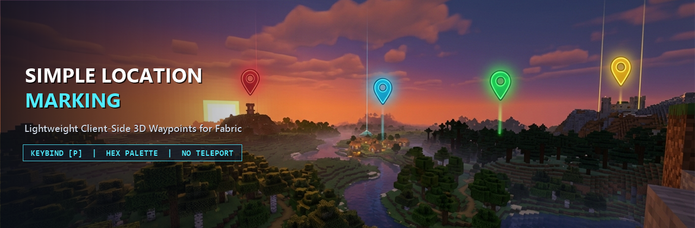

  

  <h1>Simple Location Marking</h1>
  
<strong>Lightweight, High-FPS Client-Side 3D Waypoints for Minecraft Fabric 1.21.11</strong>

  

    
    
    
    
    
  

  

    <a href="#english-documentation"><strong>[ English Documentation ]</strong></a>
    &nbsp;|&nbsp;
    <a href="#tai-lieu-tieng-viet"><strong>[ Tài Liệu Tiếng Việt ]</strong></a>
  

---

## English Documentation

### Overview

**Simple Location Marking** is a lightweight, client-side location marking mod for Minecraft Fabric `1.21.11`, directly inspired by the **Waypoints** feature of **Xaero's Minimap** and crafted with a sleek **Translucent Dark Glass** UI aesthetic.

Many players love clean, readable 3D in-world waypoint markers, but do not want a heavy radar/minimap overlay on their screen or unfair teleportation commands that break survival progression. **Simple Location Marking** focuses purely on fast, fair-play location marking: mark important coordinates, customize them with an MS Paint-style hexagon color palette and live marker preview, and see crisp, constant-size translucent glass markers in the world with zero FPS impact and strictly **no teleportation features**.

---

### Key Features

- **Translucent Dark Glass In-Game HUD Markers:**
  - Renders 3D world-anchored markers at `(x + 0.5, y + 1.0, z + 0.5)` visible through terrain so you never lose your way back to your base, portal, village, or mine.
  - **Constant Screen-Space Size & Infinite-Distance Visibility:** Normalizes the camera-relative direction vector onto a unit sphere before applying view/projection matrices, guaranteeing that waypoints at `10m`, `500m`, or `50km+` (far beyond Vanilla's render distance and far clip plane) never clip and always render at the exact same compact screen-space size.
  - **Compact Default Badge:** Displays a centered `16x16` dark glass badge (`0xA6101218`) with a crisp `1px` outer border + `2px` top accent bar in the waypoint's RGB color and the brightly tinted **uppercase first letter** of the location name.
  - **Crosshair Hover Expansion:** When you aim your crosshair close to a marker, the badge smoothly expands into a translucent dark glass pill (`0xBF101218`) revealing the **full location name** (first letter capitalized).
  - **High-Contrast Distance Pill:** Renders the distance directly below the badge inside a compact `0.75x`-scaled translucent dark pill (`0x80000000`) with crisp light text (`0xFFE0E0E0`) so it stays readable against bright sky, snow, or lava.
- **Smart Distance Formatting:**
  - Displays Euclidean distance in meters (`<number>m`, such as `145m`) when under `10000` meters.
  - Automatically switches to kilometers with one decimal place (`<number>km`, such as `10.5km`) when `10000` meters or farther.
- **Translucent Dark Glass Management & Add/Edit Screens:**
  - Renders a subtle dark translucent full-screen overlay (`0x7008090C`) over the live game world (without opaque dirt backgrounds or heavy blur shaders that wash out colors) and a centered **Translucent Glass Main Panel** (`0xD012141C`) with a `1px` border (`0xFF2E3446`) and top header bar (`0xE01A1D28`).
  - **MS Paint-Style Hexagon Color Palette & Live Preview Box:** Features an interactive honeycomb palette with a glowing outline around the active cell, paired with a real-time **Live Color & Marker Preview Box** showing both the compact and expanded HUD marker states plus the `#RRGGBB` hex code.
- **Strict Dimension Isolation:**
  - Waypoints created in the `Overworld`, `Nether`, `The End`, or custom modded dimensions only appear in the list and on the in-game HUD while you are inside that exact dimension.
- **Automatic Per-World & Per-Server Storage:**
  - Waypoints are stored as clean JSON files inside `.minecraft/config/simplelocationmarking/`.
  - Separate files are created automatically for each Singleplayer world folder and each Multiplayer server IP address, ensuring waypoints never leak across different worlds or servers.
- **Fair-Play & Ultra-High FPS Architecture:**
  - Strictly **no teleportation** buttons or commands.
  - Zero object allocations per frame in the HUD rendering loop, ensuring zero FPS drops or micro-stutters even with dozens of active markers.
- **Bilingual Support:**
  - Built-in translations for both **English (`en_us`)** and **Vietnamese (`vi_vn`)**.

---

### Controls & GUI Guide

#### 1. Opening the Management Screen (`P` Key)
- Press **`P`** in-game (configurable in **Options -> Controls -> Key Binds** under category **Simple Location Marking**) to open the **Location Management Screen**.
- **Header Info Bar:** Displays your current **Dimension** inside an accent-colored pill badge (emerald green for `Overworld`, crimson for `Nether`, purple for `The End`) alongside a pill badge showing your standing **Coordinates (`X, Y, Z`)**.
- **Scrollable Waypoint List:** Renders inside a recessed dark translucent viewport (`0x880B0C10`) with a slim `4px` semi-transparent scrollbar. Each waypoint row is styled as an interactive card displaying:
  - A **glowing colored square swatch** with a `1px` border, the **waypoint name**, muted gray **`(X, Y, Z)` coordinates**, a right-aligned **distance pill badge** (`m`/`km`), and a distinct amber/red **`[Hidden]`** pill tag when hidden.
  - Supports mouse-wheel scrolling, scrollbar dragging, up/down arrow navigation, single-click selection, and double-click to edit.

#### 2. Bottom Action Buttons
- **`Add` (Always Enabled):** Opens the **Add Location** screen.
  - Organized into recessed translucent sub-panels for the **Location Name** input, read-only standing **`X`**, **`Y`**, and **`Z`** coordinate fields, and the **Hexagon Color Palette + Live Marker Preview Box**.
  - A random vibrant color is pre-selected on the **Hexagon Color Palette**; click any hexagon cell to pick a different color and watch the **Live Preview Box** update immediately, then click **`Add`** (or press `Enter`) to save.
- **`Edit` (Enabled when a waypoint is selected):** Opens the **Edit Location** screen.
  - Modify the **Location Name**, freely edit the integer **`X`**, **`Y`**, and **`Z`** coordinates, or pick a new color from the **Hexagon Color Palette** with live preview feedback, then click **`Submit`** to save changes.
- **`Hide/Show` (Enabled when a waypoint is selected):**
  - Immediately toggles the visibility of the selected waypoint.
  - When hidden, the waypoint displays an amber/red `[Hidden]` tag in the management list and is hidden from your in-game 3D HUD until you click **`Hide/Show`** again.
- **`Delete` (Enabled when a waypoint is selected):**
  - Permanently removes the selected waypoint from the list, JSON storage file, and in-game HUD (can also be triggered with the `Delete` key).

---

### Installation

1. Install **Minecraft `1.21.11`** with **Fabric Loader (`>= 0.19.5`)** and **Java `21`**.
2. Download and install the latest **Fabric API** for Minecraft `1.21.11`.
3. Download `simplelocationmarking-fabric-1.21.11-1.0.0.jar` and place it inside your `.minecraft/mods/` folder.
4. Launch the game and press **`P`** in any world or server to start marking locations.

---

### Compatibility & Technical Notes

- **Side:** Client-side only (`"environment": "client"`). Works on all vanilla, Fabric, Paper, Spigot, and modded multiplayer servers without needing to be installed on the server.
- **Data Path:** `.minecraft/config/simplelocationmarking/`

---
---

## Tài Liệu Tiếng Việt (Vietnamese Documentation)

### Giới Thiệu

**Simple Location Marking** là một bản mod đánh dấu vị trí (waypoint) siêu nhẹ, chạy hoàn toàn phía Client dành cho Minecraft Fabric `1.21.11`, lấy cảm hứng từ chức năng **Waypoints** của **Xaero's Minimap** và được thiết kế theo phong cách giao diện **Kính Tối Trong Suốt (Translucent Dark Glass)** hiện đại.

Rất nhiều người chơi yêu thích kiểu hiển thị cột mốc 3D trực quan trong thế giới nhưng không muốn màn hình bị chiếm diện tích bởi bản đồ thu nhỏ (minimap) hoặc không muốn các tính năng dịch chuyển tức thời (teleport) làm mất tính công bằng khi chơi sinh tồn. **Simple Location Marking** được xây dựng dành riêng cho nhu cầu đó: gọn nhẹ, sắc nét ở mọi khoảng cách, không gây tụt FPS và **hoàn toàn không có tính năng Teleport**.

---

### Tính Năng Chính

- **Cột Mốc HUD Trong Game Phong Cách Kính Tối Hiện Đại:**
  - Hiển thị các điểm đánh dấu 3D tại vị trí `(x + 0.5, y + 1.0, z + 0.5)` nhìn xuyên qua địa hình, giúp bạn dễ dàng định hướng đường về nhà, cổng Nether, làng dân hoặc khu mỏ.
  - **Kích Thước Cố Định Ở Mọi Khoảng Cách & Không Bao Giờ Bị Cắt (Far-Clip):** Chuẩn hóa vector hướng tương đối từ camera lên mặt cầu đơn vị trước khi nhân ma trận chiếu, đảm bảo các điểm đánh dấu ở `10m`, `500m` hay `50km+` (vượt xa tầm nhìn của Vanilla) luôn hiển thị sắc nét với kích thước cố định, không bao giờ bị phóng to quá cỡ hay biến mất ở khoảng cách xa.
  - **Huy Hiệu Mặc Định Gọn Gàng:** Hiển thị huy hiệu kính tối (`16x16`, nền `0xA6101218`) với viền ngoài `1px` + thanh nhấn trên `2px` theo màu của điểm đánh dấu và **chữ cái đầu viết hoa** nổi bật ở chính giữa.
  - **Mở Rộng Mượt Mà Khi Hướng Tâm Ngắm (Crosshair):** Khi đưa tâm ngắm vào gần điểm đánh dấu, huy hiệu tự động mở rộng thành viên nang kính tối (`0xBF101218`) hiển thị **đầy đủ tên vị trí** (viết hoa chữ cái đầu).
  - **Nhãn Khoảng Cách Rõ Nét Bên Dưới:** Hiển thị khoảng cách bên trong khung nền tối bán trong suốt (`0x80000000`, tỷ lệ `0.75x`, chữ sáng `0xFFE0E0E0`) giúp đọc rõ ngay cả trên nền trời sáng, tuyết hoặc dung nham.
- **Định Dạng Khoảng Cách Thông Minh:**
  - Hiển thị khoảng cách bằng đơn vị mét (`<số>m`, ví dụ: `145m`) khi khoảng cách dưới `10000` mét.
  - Tự động chuyển sang đơn vị kilômét với 1 chữ số thập phân (`<số>km`, ví dụ: `10.5km`) khi khoảng cách từ `10000` mét trở lên.
- **Giao Diện Quản Lý & Thêm/Sửa Phong Cách Kính Tối (Translucent Dark Glass):**
  - Phủ lớp nền tối mờ nhẹ (`0x7008090C`) trực tiếp lên thế giới đang chơi (không dùng nền đất đặc hay hiệu ứng làm mờ nặng làm nhạt màu) cùng khung kính chính (`0xD012141C`) có viền `1px` sắc nét (`0xFF2E3446`) và thanh tiêu đề phía trên (`0xE01A1D28`).
  - **Bảng Chọn Màu Lục Giác MS Paint & Khung Xem Trước Trực Tiếp (Live Preview):** Ô lục giác đang chọn có viền phát sáng nổi bật, đi kèm khung **Xem trước (Live Preview)** ngay bên cạnh giúp bạn thấy ngay hình dáng huy hiệu thu gọn và mở rộng của điểm đánh dấu cùng mã màu `#RRGGBB`.
- **Tách Biệt Theo Chiều Không Gian (Dimension Isolation):**
  - Các vị trí đánh dấu tại `Overworld`, `Nether`, `The End` hoặc chiều không gian từ mod khác chỉ hiển thị trong danh sách và trên màn hình HUD khi bạn đang ở đúng chiều không gian đó.
- **Lưu Trữ Riêng Biệt Cho Từng Thế Giới & Server:**
  - Dữ liệu được lưu dưới dạng file JSON tại `.minecraft/config/simplelocationmarking/`.
  - Mod tự động tách file lưu trữ dựa trên tên thư mục thế giới Singleplayer hoặc địa chỉ IP của Server Multiplayer, đảm bảo các điểm đánh dấu không bao giờ bị lẫn lộn giữa các thế giới hay máy chủ khác nhau.
- **Hiệu Năng Cao & Chơi Công Bằng (Fair-Play):**
  - **Không có chức năng dịch chuyển (Teleport)** dưới bất kỳ hình thức nào.
  - Thuật toán tính toán ma trận camera và vẽ HUD không cấp phát bộ nhớ thừa mỗi khung hình (zero per-frame allocation), giữ nguyên mức FPS cao và ổn định.
- **Hỗ Trợ Đa Ngôn Ngữ:**
  - Tích hợp sẵn đầy đủ bản dịch **Tiếng Anh (`en_us`)** và **Tiếng Việt (`vi_vn`)**.

---

### Hướng Dẫn Thao Tác Phím `P`

#### 1. Mở Giao Diện Quản Lý (Phím `P`)
- Nhấn phím **`P`** khi đang trong game (có thể đổi phím tắt trong **Options -> Controls -> Key Binds** tại danh mục **Simple Location Marking**) để mở **Giao Diện Quản Lý Vị Trí Đánh Dấu**.
- **Thanh Thông Tin Đầu Trang:** Hiển thị huy hiệu **Chiều không gian** với màu sắc đặc trưng (xanh ngọc lục bảo cho `Overworld`, đỏ thẫm cho `Nether`, tím cho `The End`) cùng huy hiệu **Tọa độ đang đứng (`X, Y, Z`)**.
- **Danh Sách Vị Trí Dạng Thẻ (Card Rows):** Nằm trong khung nền tối (`0x880B0C10`) với thanh cuộn mảnh `4px` bán trong suốt. Mỗi dòng là một thẻ hiển thị:
  - **Ô màu phát sáng** có viền `1px`, **tên vị trí**, **tọa độ `(X, Y, Z)`** màu xám dịu, **huy hiệu khoảng cách (`m`/`km`)** căn phải, và nhãn **`[Đã ẩn]`** màu cam/đỏ nổi bật khi vị trí đang ẩn.
  - Hỗ trợ lăn chuột, kéo thanh cuộn, phím mũi tên Lên/Xuống, nhấp chuột để chọn, hoặc nhấp đúp chuột để mở nhanh giao diện Chỉnh sửa.

#### 2. Các Nút Chức Năng Bên Dưới
- **`Add` / `Thêm` (Luôn Bật):** Mở giao diện **Thêm Vị Trí Đánh Dấu**.
  - Các khu vực nhập **Tên vị trí**, tọa độ chỉ đọc **`X`**, **`Y`**, **`Z`**, và **Bảng màu lục giác + Khung Xem Trước** được bố trí trong các khung kính phụ gọn gàng.
  - Một màu ngẫu nhiên trên **Bảng màu lục giác** sẽ được chọn sẵn; nhấp vào bất kỳ ô lục giác nào để đổi màu và quan sát khung **Xem trước** cập nhật tức thì, sau đó nhấn **`Add` / `Thêm`** (hoặc phím `Enter`) để lưu.
- **`Edit` / `Sửa` (Bật khi đã chọn 1 vị trí):** Mở giao diện **Chỉnh Sửa Vị Trí**.
  - Cho phép chỉnh sửa **Tên vị trí**, thay đổi trực tiếp các giá trị số nguyên **`X`**, **`Y`**, **`Z`**, và chọn lại màu sắc trên **Bảng màu lục giác** kèm khung xem trước trực tiếp, sau đó nhấn **`Submit` / `Xác nhận`** để cập nhật.
- **`Hide/Show` / `Ẩn/Hiện` (Bật khi đã chọn 1 vị trí):**
  - Bật/tắt nhanh trạng thái hiển thị của vị trí đang chọn.
  - Khi bị ẩn, vị trí sẽ có nhãn `[Đã ẩn]` nổi bật trong danh sách và không hiển thị trên màn hình 3D trong game cho đến khi bạn nhấn **`Hide/Show` / `Ẩn/Hiện`** một lần nữa.
- **`Delete` / `Xóa` (Bật khi đã chọn 1 vị trí):**
  - Xóa vĩnh viễn vị trí đang chọn khỏi danh sách, file lưu trữ và màn hình HUD trong game.

---

### Cài Đặt

1. Cài đặt **Minecraft `1.21.11`** với **Fabric Loader (`>= 0.19.5`)** và **Java `21`**.
2. Tải và cài đặt **Fabric API** phù hợp cho phiên bản `1.21.11`.
3. Copy file `simplelocationmarking-fabric-1.21.11-1.0.0.jar` vào thư mục `.minecraft/mods/`.
4. Khởi động game và nhấn phím **`P`** để bắt đầu đánh dấu vị trí.

---

### Ủng Hộ Tác Giả (Support the Author)

Nếu bạn thấy mod hữu ích, hãy ủng hộ tác giả **thaistoanf** qua Ko-fi:
- **Ko-fi:** [https://ko-fi.com/thaistoanf](https://ko-fi.com/thaistoanf)
