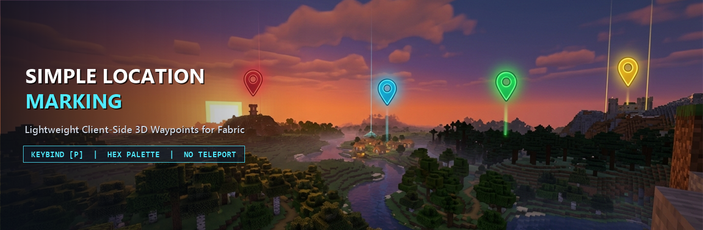

  

      
  

  

    
  

  <h1>Simple Location Marking</h1>
  
<strong>Lightweight, High-FPS Client-Side 3D Waypoints with a Sleek Translucent Dark Glass UI</strong>

---

## Overview

**Simple Location Marking** is a lightweight, client-side location marking mod directly inspired by the **Waypoints** system from **Xaero's Minimap** and styled with a modern **Translucent Dark Glass** aesthetic.

It is designed specifically for players who want clean, readable 3D in-world location markers without installing a heavy minimap overlay or teleportation cheats. Mark important places in seconds, organize them with an MS Paint-style hexagon color palette and live marker preview, and navigate effortlessly at any distance with zero impact on your frame rate.

---

## Key Features

- **Translucent Dark Glass In-Game 3D Markers:**
  - Projects 3D waypoint markers directly onto your HUD anchored to their exact world coordinates `(x + 0.5, y + 1.0, z + 0.5)` and visible through terrain.
  - **Constant Screen-Space Size at Any Distance:** Projects normalized camera-relative direction vectors onto a unit sphere before applying view/projection transforms, ensuring waypoints at `10m`, `500m`, or `50km+` (far beyond Vanilla's render distance) never clip and always render at the exact same compact screen-space size.
  - **Compact Default Badge:** Displays a sleek `16x16` dark glass badge (`0xA6101218`) with a `1px` outer border + `2px` top accent bar in the waypoint's RGB color and the brightly tinted **uppercase first letter** of the waypoint's name in the center.
  - **Dynamic Crosshair Hover Pill:** When you aim your crosshair toward a marker, the badge smoothly expands into a translucent dark glass pill (`0xBF101218`) to display the **full waypoint name** (with its first letter capitalized).
  - **Readable Distance Label (`m` and `km`):** Renders real-time Euclidean distance (`<number>m` below `10000m`, `<number>km` at `10000m` and beyond) directly below the badge inside a compact `0.75x`-scaled dark pill (`0x80000000`, `0xFFE0E0E0` text) that remains crisp against sky, snow, or lava.
- **MS Paint-Style Hexagon Color Palette & Live Preview:**
  - Includes a custom interactive honeycomb color picker built from concentric hexagon rings covering the full HSV/RGB spectrum plus a grayscale row at the bottom, with a crisp glowing outline around the selected cell.
  - Features a real-time **Live Color & Marker Preview Box** next to the palette so you can immediately see how both the compact badge and expanded hover pill will look in-game.
- **Dimension Isolation:**
  - Waypoints are strictly separated by dimension (`Overworld`, `Nether`, `The End`, and custom dimensions). Only markers belonging to your current dimension are listed in the management screen and rendered on the HUD.
- **Automatic Per-World & Per-Server Storage:**
  - Waypoints are saved as JSON files inside `.minecraft/config/simplelocationmarking/`.
  - Separate storage files are generated automatically based on the active Singleplayer world folder name or Multiplayer server IP address so markers never leak across different worlds or servers.
- **Built-In Localization:**
  - Includes full English (`en_us`) and Vietnamese (`vi_vn`) translations out of the box.

---

## GUI & Controls Guide

### 1. Main Management Screen (`P` Key)

- Press **`P`** in-game (rebindable in **Options -> Controls -> Key Binds** under **Simple Location Marking**) to open the **Location Management Screen**, rendered over a subtle dark translucent overlay (`0x7008090C`) without opaque dirt backgrounds or color-washing blur shaders.
- **Header Info Bar:** Displays your current **Dimension** inside an accent-colored pill badge (emerald green for `Overworld`, crimson for `Nether`, purple for `The End`) and your standing **Coordinates (`X, Y, Z`)** in a companion pill box.
- **Scrollable Waypoint List:** Displays every waypoint in your current dimension inside a recessed dark glass viewport (`0x880B0C10`) with a slim `4px` semi-transparent scrollbar. Each row card shows:
  - A **glowing colored square swatch** with a `1px` border, the **waypoint name**, muted gray **`(X, Y, Z)` coordinates**, a right-aligned **distance badge** (`m`/`km`), and a distinct amber/red **`[Hidden]`** (`[Đã ẩn]`) badge when hidden.
  - Click any row card to select that waypoint, or double-click a row card to edit it directly.

### 2. Action Buttons

- **`Add` (Always Enabled):**
  - Opens the **Add Location** screen with well-spaced translucent sub-panels for the **Location Name** field, read-only **`X`**, **`Y`**, and **`Z`** coordinate fields pre-filled with your current standing block position, and the **Hexagon Color Palette + Live Marker Preview Box** with a random vibrant color pre-selected.
  - Click **`Add`** (or press `Enter`) to save the new waypoint and return to the main list.
- **`Edit` (Enabled when a waypoint is selected):**
  - Opens the **Edit Location** screen pre-populated with the selected waypoint's current data.
  - Allows you to edit the **Location Name**, modify the integer **`X`**, **`Y`**, and **`Z`** coordinates, and choose a new color on the **Hexagon Color Palette** with live preview feedback.
  - Click **`Submit`** (or press `Enter`) to save your changes.
- **`Hide/Show` (Enabled when a waypoint is selected):**
  - Immediately toggles the visibility state of the selected waypoint.
  - Hidden waypoints show an amber/red `[Hidden]` tag in the management list and are not rendered on the in-game 3D HUD until toggled back on.
- **`Delete` (Enabled when a waypoint is selected):**
  - Removes the selected waypoint from the management list, storage file, and in-game HUD.

---

## Performance & Fair-Play Philosophy

- **Strictly No Teleportation:** Simple Location Marking is built for authentic survival gameplay. There are no teleport buttons or cheat commands, keeping exploration and travel meaningful.
- **Zero Per-Frame Allocations:** Camera projection math, sorting buffers, and text measurements are cached and reused across frames so the HUD renderer runs with zero garbage collection pressure and zero FPS drops.
- **Purely Client-Side:** Runs entirely on the client and works seamlessly in Singleplayer worlds as well as on any Multiplayer server without requiring server-side installation.

---

## Installation

1. Install the appropriate mod loader and required API library for your game version.
2. Download the **Simple Location Marking** `.jar` file matching your game version.
3. Place the `.jar` file into your `.minecraft/mods/` directory.
4. Launch the game and press **`P`** in-game to manage your locations.

---

## Support the Project

If you enjoy **Simple Location Marking**, consider supporting development on Ko-fi:

- **Ko-fi:** [https://ko-fi.com/thaistoanf](https://ko-fi.com/thaistoanf)
